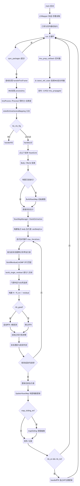

# FAST-LIVO2-RTK 实际执行流程图与算法说明

## 1. 总体流程图（按代码真实调用链）

---

## 2. 启动与主循环

### 2.1 程序入口
- 入口函数在 [src/main.cpp](../src/main.cpp#L3)
- 创建 `LIVMapper`，然后调用 `run()` 进入持续处理循环

### 2.2 主循环逻辑
主循环在 [src/LIVMapper.cpp](../src/LIVMapper.cpp#L607)：
1. `ros::spinOnce()` 拉取最新传感器消息
2. `sync_packages(...)` 做多传感器时间同步
3. 首帧初始化 `handleFirstFrame()`
4. `processImu()` 做预测与去畸变
5. `stateEstimationAndMapping()` 做 LIO/VIO 更新与建图

核心逻辑：**不同步就不更新**，避免错时数据污染状态估计。

---

## 3. IMU 预测与去畸变

### 3.1 调用位置
- `processImu()` 在 [src/LIVMapper.cpp](../src/LIVMapper.cpp#L261)
- 核心调用 `p_imu->Process2(...)` 在 [src/LIVMapper.cpp](../src/LIVMapper.cpp#L265)

### 3.2 算法
- 采用 IMU 预积分/离散传播思想，更新姿态、速度、位置、协方差
- 利用扫描期间的运动估计对点云做去畸变（`feats_undistort`）
- 可选重力对齐 `gravityAlignment()`（[src/LIVMapper.cpp](../src/LIVMapper.cpp#L243)）

### 3.3 输出
- 预测状态 `state_propagat`
- 去畸变点云 `feats_undistort`
- 同步给 `voxelmap_manager->state_` 与 `voxelmap_manager->feats_undistort_`

---

## 4. 模式分支调度（VIO / LIO / LO）

分发函数在 [src/LIVMapper.cpp](../src/LIVMapper.cpp#L278)：
- `VIO`：走 `handleVIO()`（视觉-激光-IMU）
- `LIO/LO`：走 `handleLIO()`（激光主链）

本文重点是你关心的 LIO 不确定性链路，因此下面展开 `handleLIO + StateEstimation`。

---

## 5. LIO 主链（点云到状态）

### 5.1 预处理
在 [src/LIVMapper.cpp](../src/LIVMapper.cpp#L422-L448)：
1. 空点云检查
2. `VoxelGrid` 下采样（降计算复杂度）
3. Body->World 坐标变换

算法本质：降低点数量后，在世界系做几何匹配。

### 5.2 地图初始化
- 首次进入时调用 `BuildVoxelMap()`（[src/LIVMapper.cpp](../src/LIVMapper.cpp#L450-L455)）
- 地图是体素+八叉树结构，叶子面元由 PCA/特征分解拟合

### 5.3 状态估计入口
- 调 `voxelmap_manager->StateEstimation(...)` 在 [src/LIVMapper.cpp](../src/LIVMapper.cpp#L464)

---

## 6. StateEstimation 内部流程（核心）

函数位置：[src/voxel_map.cpp](../src/voxel_map.cpp#L338)

### 6.1 每点基础协方差构造
- `calcBodyCov(...)`（[src/voxel_map.cpp](../src/voxel_map.cpp#L354)）
- 得到点在 body 系下的测量协方差 `body_cov_list_`
- 同时构造力矩臂叉乘矩阵 `cross_mat_list_`

算法：将激光距离噪声与角噪声映射为 3D 点协方差。

### 6.2 迭代优化框架（IEKF）
- 外层 `for iterCount < max_iterations_`（[src/voxel_map.cpp](../src/voxel_map.cpp#L374)）
- 每轮都基于最新 `state_` 重算点世界坐标与世界协方差

逻辑：这是“重线性化”的迭代 EKF 过程，不是一次线性化就结束。

### 6.3 并行数据关联
- `BuildResidualListOMP(...)`（[src/voxel_map.cpp](../src/voxel_map.cpp#L395), [src/voxel_map.cpp](../src/voxel_map.cpp#L700)）
- 对每个点并行查体素；必要时查邻近体素
- `build_single_residual(...)` 递归下探八叉树（[src/voxel_map.cpp](../src/voxel_map.cpp#L775)）

算法：体素哈希 + 八叉树递归局部搜索。

### 6.4 匹配判定逻辑
在 [src/voxel_map.cpp](../src/voxel_map.cpp#L794-L795)：
1. 先做统计门限：$|d| < \sigma_{num}\sqrt{\sigma_l}$
2. 再算似然：$p \propto \frac{1}{\sqrt{\sigma_l}}\exp\left(-\frac{d^2}{2\sigma_l}\right)$
3. 同一点保留概率最大的候选平面

逻辑：不是纯“最近距离”，而是“残差 + 不确定性联合最优”。

### 6.5 加权残差构建（uncertainty 进入权重）
关键行 [src/voxel_map.cpp](../src/voxel_map.cpp#L456)：

$$
R^{-1}(i) = \frac{1}{0.001 + \sigma_{plane}^2 + \sigma_{point}^2}
$$

并构建：
- `Hsub`（测量 Jacobian）[src/voxel_map.cpp](../src/voxel_map.cpp#L461)
- `Hsub_T_R_inv`（加权 Jacobian）[src/voxel_map.cpp](../src/voxel_map.cpp#L462)
- `meas_vec`（残差）[src/voxel_map.cpp](../src/voxel_map.cpp#L464)

逻辑：不确定性大 -> 权重小 -> 对状态更新影响自动减弱。

### 6.6 RTK 观测拼接（可选）
当 `rtk_good` 时在同一系统追加 3 维观测（[src/voxel_map.cpp](../src/voxel_map.cpp#L467-L511)）：
- RTK 残差 `rtk_residual`
- RTK 权重 $1/\sigma_{rtk}^2$
- 拼接到 `Hsub / R_inv / meas_vec`

逻辑：激光几何约束与 RTK 绝对位置约束在同一加权方程中融合。

### 6.7 迭代 EKF 更新
核心计算在 [src/voxel_map.cpp](../src/voxel_map.cpp#L521-L545)：
- $H^T W z$
- $H^T W H$
- 与先验协方差融合，解增量 `solution`
- 按旋转/平移增量阈值做收敛判定
- 满足停止条件后更新后验协方差

算法：迭代误差状态 EKF（IEKF 风格）+ 信息加权最小二乘。

---

## 7. 地图更新与维护

### 7.1 增量更新
- `UpdateVoxelMap(...)` 在 [src/LIVMapper.cpp](../src/LIVMapper.cpp#L518)
- 把当前帧有效点及其不确定性写回体素地图

### 7.2 地图滑窗
- 若 `map_sliding_en` 打开，执行 `mapSliding()`（[src/LIVMapper.cpp](../src/LIVMapper.cpp#L523-L526)）

逻辑：限制地图规模，保持实时性和局部一致性。

---

## 8. RTK 后处理分支（独立 KF）

LIO 更新后，如果 `rtk_en && rtk_ini`，还会执行一次 `handleRTK()`（[src/LIVMapper.cpp](../src/LIVMapper.cpp#L293-L295)）。

在 [src/LIVMapper.cpp](../src/LIVMapper.cpp#L301-L359)：
- 构造 RTK 观测模型（位置）
- 计算 Kalman 增益
- 更新状态与协方差

说明：该工程里 RTK 既可能在 `StateEstimation` 里联合，也可能在 `handleRTK` 再做一轮独立修正。

---

## 9. 高频 IMU 里程计支路

`imu_prop_callback()` 在 [src/LIVMapper.cpp](../src/LIVMapper.cpp#L669)：
- 从 `latest_ekf_state` 出发
- 用新到 IMU 做短时前向传播 `prop_imu_once`
- 发布 `/LIVO2/imu_propagate`

算法：纯运动学积分（姿态指数映射 + 速度/位置离散积分），目标是低延迟显示。

---

## 10. 一句话总览

FAST-LIVO2-RTK 的实际执行闭环是：

**时间同步 -> IMU 预测/去畸变 -> 体素地图关联 -> 不确定性加权 IEKF 更新 -> 地图增量维护 ->（可选）RTK 约束修正 -> 高频 IMU 前向发布。**

其中你最关心的“uncertainty 进入求解”发生在 `StateEstimation` 的 **残差筛选、权重构造、加权方程求解** 三个连续环节。